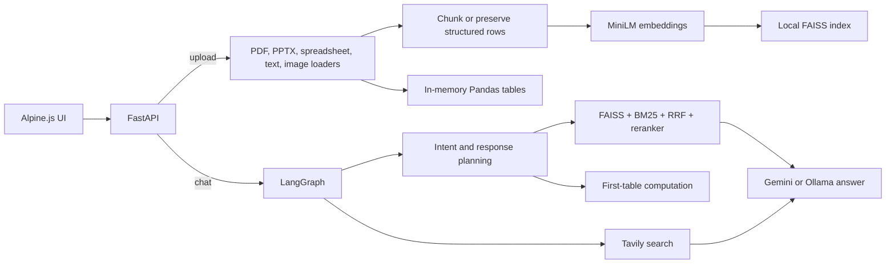
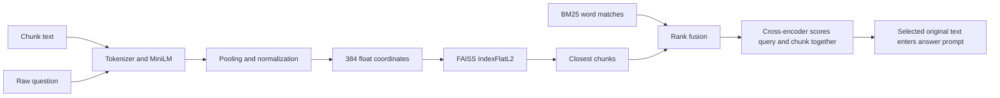

# Document QA architecture review

Reviewed 25 October 2026; extended with an adversarial audit on 26 October 2026. Scope: current repository, static UI analysis with [REA](https://github.com/morluto/rea), source and installed-dependency inspection, and synthetic offline failure probes. Business requirements below are **inferred product needs**, not validated customer requests. The detailed agent, embedding, and memory analysis appears below the initial review.

## Current architecture observation — 27 October 2026

The sections below preserve the historical audit. The current implementation has moved beyond that baseline: API/rendering boundaries and workspace-scoped immutable corpora are in place; ingestion runs in bounded parser processes and retains JSON/PDF provenance and source reports; real local embedding models pass compatibility checks; deterministic table routing passes its offline acceptance cases. SQLite conversation transcripts survive restart, and graph calls run off the API event loop. Retrieval preserves chunk provenance and reports fallback. One response plan reaches QA, and stable evidence IDs, corpus versions, citation validation, conflict signals, and safe abstention flow through API and UI. The latest suite passes **123 tests**. All 25 historical defect probes no longer reproduce; one rejection control passes with no probe errors. See [Step 3](docs/STEP3_RESULTS.md), [Step 4](docs/STEP4_RESULTS.md), [Step 5](docs/STEP5_RESULTS.md), [Step 6](docs/STEP6_RESULTS.md), [Step 7](docs/STEP7_RESULTS.md), [Step 8](docs/STEP8_RESULTS.md), and the [implementation plan](docs/IMPLEMENTATION_PLAN.md).

**Recommended architecture:** keep one bounded assistant runtime over server-authorized workspaces. A durable conversation record owns messages, idempotency keys, and tool events; immutable corpus versions own document/table evidence. The graph receives serializable IDs and values, while each request reconstructs authorized FAISS, DataFrame, model, and connector dependencies outside checkpoint state. One validated route/tool plan controls execution, and answer records cite versioned evidence IDs. Web, connector, and coding tools share typed result contracts, deadlines, budgets, and audit events; consequential actions require explicit approval. Parallel workers follow single-agent isolation and conflict tests.

**Build order adjustment:** the first Step 6 durable-conversation slice and Steps 7–8 local evidence path are in place. Finish Step 3 resource/OCR evidence and Step 6 shared-worker contracts, add opt-in episodic feedback, then build the general tool runtime. Production identity, safe live fetch, connector grants, coding isolation, and held-out model-quality evaluation remain prerequisites to shared deployment or fine-tuning. This ordering reduces cross-cutting rework before adding more agents.

## What the product does today

**Implementation update, 26 October:** Steps 1–2 now provide API/rendering boundaries, authorized workspace repositories, explicit provider selection, restart-safe tables, and atomic version publication. M02/V01/P03/S01/S02/P01/P04/A04 no longer reproduce; 17 other diagnostic limitations remain. See [Step 1](docs/STEP1_RESULTS.md) and [Step 2 verification/configuration](docs/STEP2_RESULTS.md). The findings below describe the audited pre-repair implementation unless this update states otherwise.

The FastAPI app serves a single-page Alpine.js UI. REA 6.8.0 recovered five UI requests from the inline script: `GET /api/state`, `GET /api/prompt-library`, `POST /api/upload`, `POST /api/chat`, and `POST /api/provider` (REA evidence `ev_df633b235ee1dceb2d17440371e0fe3b5755eb36e8e6d23007d3c198ea92f230`). REA's JavaScript analysis is static; the Python behavior below was traced from source and checked where noted with FastAPI's `TestClient`.



`app/server.py` owns routes and one process-wide `_AppState`. `ingestion/file_loader.py` handles PDF, PPTX, XLSX/XLSM, CSV/TSV, text, JSON, and image OCR. `ingestion/semantic_chunker.py` splits long text at 800 characters with 100 overlap; slides, JSON, and table records stay whole. `vector_Store/faiss_store.py` builds and persists the default LangChain FAISS Flat index in `vector_db/`. `agents/retriever_agent.py` combines vector and BM25 lists with reciprocal rank fusion, then `retrieval/reranker.py` optionally reranks. `langgraph_flow/graph_builder.py` routes web search directly to answer generation and document questions through intent, response planning, and either Pandas computation or retrieval. `agents/orchestrator_agent.py` selects Gemini or Ollama. Browser notes and chat history live in page memory; `app/main.py`, `agents/react_agent.py`, `agents/writer_agent.py`, and `memory/` are legacy or outside the active FastAPI graph.

## Highest-priority gaps

1. **Shared data and access control (critical for any multi-user deployment).** `app/server.py:36-50,100-131` stores every upload in one global state and overwrites one persisted `vector_db/`; routes have no authentication or per-user ownership check. A later user can replace or query the previous user's corpus. Add authenticated workspace IDs, isolated indexes and metadata, authorization on every read, and a deletion/retention policy before exposing the app to teams.
2. **Default Gemini path is broken.** `agents/orchestrator_agent.py:49` and `ingestion/file_loader.py:270` select `gemini-2.0-flash`; Google [lists that model as shut down](https://ai.google.dev/gemini-api/docs/deprecations/). Move model IDs into validated configuration, choose a supported stable model, and exercise provider startup checks. The Gemini Vision OCR fallback also imports `google.generativeai`, which `requirements.txt` does not declare.
3. **Untrusted HTML output (security review needed).** `app/static/index.html:453,746` renders model Markdown through `marked.parse()` into Alpine `x-html`; [Marked does not sanitize HTML](https://marked.js.org/). Sanitize rendered HTML and validate web links before rendering. Uploaded text and Tavily results also enter model prompts without an explicit untrusted-content boundary; [OWASP documents indirect prompt injection risk](https://genai.owasp.org/llmrisk/llm01-prompt-injection/). This is a code-path finding, not a demonstrated exploit.
4. **Incorrect table routing.** `agents/planner_agent.py:14-18` sends every query to the Pandas tool when any CSV/XLSX/TSV is uploaded, even if the question asks about a PDF. `agents/dataframe_tool.py:76-78` always chooses the first table and only supports whole-column summaries. A focused function check confirmed a PDF question plus CSV upload sets `use_tool=True`. Route by question and selected source; support sheet selection, filters, groups, joins, and transparent computation provenance.
5. **Answer grounding and retrieval.** BM25 uses whitespace splitting (`agents/retriever_agent.py:39,79`); RRF keys by content hash (`:50`), merging identical text from different files. A focused check reduced two distinct-source chunks to one. Reranker errors silently fall back (`retrieval/reranker.py:30-53`). The QA prompt concatenates unlabeled text and reports only the first document as `source` (`agents/qa_agent.py:21-41`), so source cards do not prove individual claims. Add stable chunk IDs, consistent tokenization, retrieval thresholds, visible reranker status, labeled evidence spans, and citation verification.
6. **Session and conversation continuity.** `utils/prompt_skill.py:107-111` returns the raw question when no optional prompt profile exists, and `agents/qa_agent.py` does not otherwise use `chat_history`. Follow-up questions therefore lack dependable context. UI notes and history disappear on reload. Persist conversation state per workspace and rewrite follow-ups before retrieval.
7. **Document coverage and planning cost.** `ingestion/file_loader.py:144-161` uses text extraction for PDFs but has no scanned-PDF OCR path; long slides and JSON bypass splitting. `agents/intent_classifier.py` and `agents/response_planner.py` can each call an LLM before retrieval, while `agents/qa_agent.py` does not apply the generated `response_plan` to its answer format. Add ingestion quality checks and measure whether the extra planning calls improve answers enough to justify their latency and cost.

## Delivery and operations limits

- Uploads are fully read into memory without size, count, processing-time, or quota limits (`app/server.py:100-125`). Embedding and LLM work runs synchronously inside async route handlers. Use bounded ingestion jobs, progress/status, and operational limits before larger workloads.
- The initial review found no automated tests, evaluation set, CI pipeline, dependency lock, deployment manifest, structured traces, cost accounting, or p95 latency measurements. The adversarial audit now adds a reproducible diagnostic harness; a quality regression suite is still needed. `requirements.txt` leaves versions unpinned. Add a small golden QA set covering retrieval, citations, tabular math, missing evidence, and provider failure before tuning indexes.
- `vector_Store/faiss_store.py:53-56` loads the persisted index with dangerous deserialization enabled. Protect index ownership/integrity or remove pickle-based loading before accepting external index artifacts.
- README still describes Streamlit and omits current hybrid retrieval and OCR behavior. CDN-hosted Alpine/Marked scripts are unpinned, which adds availability and change-control risk.

## Inferred business needs and sequence

**First: dependable single-user analyst workflow.** Repair the Gemini default, correct table routing, add claim-level citations and follow-up handling, and measure answer quality on representative PDFs, spreadsheets, and cross-file questions. This supports the core promise: faster document analysis with evidence users can check.

**Next: safe team workspace.** Add identity, document ownership, separate durable corpora, retention/deletion, upload limits, sanitized rendering, audit events, and provider/data-routing controls. This is the minimum foundation for confidential enterprise documents.

**Then: scale and integrations.** Add incremental ingestion, searchable source/version metadata, connector sync, background jobs, observability, and cost/latency budgets. Keep exact FAISS Flat as the baseline; compare HNSW, IVF, or PQ only after corpus size, recall, memory, and latency measurements justify a switch. [Faiss's index guide](https://github.com/facebookresearch/faiss/wiki/Guidelines-to-choose-an-index) explains those tradeoffs.

## Initial verification and limits — 25 October

REA static analysis identified all five UI `fetch` endpoints after the inline script was extracted for inspection. FastAPI `TestClient` returned 200 for `/` and `/api/state`, 422 for chat without a corpus, 422 for an unsupported upload, and 422 for an invalid provider. Python syntax compilation passed. No live Gemini/Ollama call, real document ingestion, browser exploit test, load test, or customer discovery was performed; those outcomes remain unverified.

## Adversarial audit — 26 October

**Result: 25 failure or limitation probes reproduced; one rejection control passed; no probe errors.** These are observations across several root causes, not 25 independent vulnerabilities. The harness is [tools/audit_failure_modes.py](tools/audit_failure_modes.py); individual inputs, outputs, dependency versions, and graph traces are retained in [docs/failure-mode-evidence.json](docs/failure-mode-evidence.json).

Run from the repository root with the project dependencies installed:

```bash
python3 -m tools.audit_failure_modes --output docs/failure-mode-evidence.json
```

The harness blocks network connections, stubs model responses, uses synthetic documents, and writes FAISS files only in temporary directories. HTTP handler probes use explicit test state without starting model-loading services. The restart probe invokes startup against a temporary saved index. It records undesirable behavior: `reproduced` is a finding, and exit code zero means the probes executed successfully. It does not certify application correctness.

### How the active agent system works

The active graph in [langgraph_flow/graph_builder.py](langgraph_flow/graph_builder.py) is an acyclic workflow of Python functions. Each request supplies a fresh `AgentState`; functions update it and route to the next node. Runtime traces with stubbed providers confirmed:

- **Document question:** entry → intent classifier → response planner → deterministic planner → hybrid retriever → QA. Three application-level LLM invocations on the successful path: classify, plan, answer.
- **Table question:** entry → classifier → response planner → planner → dataframe tool → end. Two LLM invocations, followed by fixed Pandas operations. The tool result bypasses final QA.
- **Web mode:** entry → Tavily → QA → end. One QA LLM invocation, plus Tavily's search/answer service. It bypasses uploaded-document retrieval rather than combining web and local evidence.

Counts exclude provider retries, Ollama fallback attempts, and the separate suggested-question call during upload. None of the three compiled paths has a checkpointer. There is no active reflection loop, evidence verifier, tool retry policy, or episodic recall node. The response planner can overwrite the classifier's intent, but its requested sections and retrieval focus are not consumed by the final QA prompt or search query (A05). This adds latency without enforcing the promised response plan.

`agents/react_agent.py` contains richer history/plan prompting but is not wired into the active graph. It also performs a single generation, not an iterative ReAct tool loop. The alternative `langgraph_flow/router.py` is unused by FastAPI; its writer expects `draft_answer`, while its preceding QA node writes `response`. Activating that legacy graph without repair can replace an answer with “Unable to generate answer.” No arbitrary Python execution tool is present in the active workflow.

### How embeddings and retrieval work internally

The configured encoder defaults to `sentence-transformers/all-MiniLM-L6-v2`. It tokenizes chunk text, creates contextual token representations, pools them, and produces a 384-number vector. The published model includes a Normalize stage and truncates inputs beyond its 256-wordpiece limit. These are upstream model facts; local model weights were not loaded in this audit. [Model card](https://huggingface.co/sentence-transformers/all-MiniLM-L6-v2), [module configuration](https://huggingface.co/sentence-transformers/all-MiniLM-L6-v2/blob/main/modules.json).



Installed LangChain code confirms `FAISS.from_documents()` embeds `page_content`, creates `IndexFlatL2`, and stores original documents in a separate docstore. Search embeds the raw question using the configured embedding object and ranks squared Euclidean distances. For unit vectors, that order agrees with cosine similarity. The app does not enforce normalization for arbitrary replacement models, so the encoder and metric need an explicit compatibility contract.

The encoder is inference-only: uploading files does not train it or the answer model. Source/page metadata is kept alongside vectors; it is not automatically part of the embedded text. The cross-encoder is a separate scoring model, not conversation memory. Gemini/Ollama generates the final answer from selected text.

Confirmed embedding/retrieval break points:

- **E01:** save a two-dimensional test index, reload with a three-dimensional query encoder. Loading succeeds; search raises `AssertionError`.
- **E02:** reload with an incompatible encoder that has the same dimension. The test query switches from `alpha.txt` to `beta.txt` without an exception. The app stores no model/revision fingerprint to reject this mismatch. This uses synthetic coordinate systems to test the real persistence contract, not to measure MiniLM accuracy.
- **E03:** changing `EMBEDDING_MODEL` in a running process leaves the cached model unchanged. Both the embedding factory and vector-store accessor cache model objects. Make restart/rebuild semantics explicit.
- **I01:** an 18,130-character JSON document remains one chunk. JSON, slides, and table records bypass normal splitting, so their tail content can exceed encoder limits. Character-based splitting also does not guarantee a token limit for ordinary text.
- **R01–R04:** same text from two sources collapses to one; `Refund` matches while `refund?` scores zero; zero lexical overlap plus zero vector hits still returns three chunks; a failed reranker load caches `None`, preventing another load attempt until invalidation or restart.

Fix by persisting an index manifest containing encoder identity/revision, dimension, normalization, metric, and chunking version. Validate it before serving queries and rebuild into a new version when it changes. Use token-aware chunks with source/position IDs, preserve provenance when deduplicating, reject weak evidence using calibrated relevance checks, and make reranker availability observable.

### Conversation, episodic, and machine memory

**Conversation memory is incomplete.** The browser holds `chatHistory` in JavaScript memory and sends it with each chat request (`app/static/index.html:579,657`). Reloading the page clears it. Without an optional prompt-profile body, `build_prompted_query()` returns only the current question (M01). With a profile, only the last four messages are formatted, with no token budget. Retrieval always searches the raw question; “What about its deadline?” is never rewritten with the prior topic before retrieval. The answer may therefore see history while still receiving the wrong evidence.

The request accepts arbitrary history dictionaries. A null `role` passes validation but produces HTTP 500 when a profile is active (M02). Clients can also supply forged roles/content; no server-owned conversation record validates their provenance. Persist bounded messages under authenticated `workspace_id` and `conversation_id`, validate role/content schemas, and construct history independently of optional prompt profiles.

**The memory helper is not connected.** `memory/conversation_memory.py` defines an in-process list. `get_memory()` creates a new empty object every call (M03); this is factory behavior, not persistence. Its loader copies the list but shares the contained dictionaries, so editing a returned message changes stored history (M04). There is no disk store, eviction, summarization, user namespace, or use of this helper in the active request path. Adding an import alone would not fix conversation continuity.

**Episodic memory is absent.** Nothing records a completed task, tool decisions, evidence versions, outcome, or user correction for later retrieval. The FAISS document corpus is searchable uploaded knowledge; it does not remember prior agent experiences. LangGraph distinguishes thread-scoped conversation state from longer-lived memory such as experiences. [Memory guidance](https://docs.langchain.com/oss/python/concepts/memory).

For this project, add episodic storage only after reliable conversation identity and evidence tracking. A useful episode contains `workspace_id`, `conversation_id`, `task`, selected tool/source IDs, document versions, outcome, user validation, and timestamp. Recall only relevant authorized episodes and retain a link to original evidence. An old answer must not become an authoritative fact simply because it was saved. Include correction, deletion, retention, and stale-source invalidation. A local SQLite-backed store suits the single-process prototype; a shared database is needed for multiple workers. A graph checkpointer can persist conversation state, while an explicit episode store holds selected validated outcomes.

**RAM and caches have different roles.** Upload bytes, parsed text, chunk documents, embeddings, Pandas frames, BM25 tokens, model weights, and request history can coexist in memory. Spreadsheet loading parses files once for retrieval documents and again for tabular assets. Browser history stores source excerpts in `cards` and resends these extra fields on later requests even though generation uses only roles/content. This grows both client memory and request sizes as conversations lengthen; no heap/load benchmark was performed. Raw 384-dimensional float32 vectors alone require `N × 384 × 4` bytes, before text, Python objects, and models.

Bound upload bytes and concurrent jobs, preserve numeric DataFrames separately from text formatting, send only necessary history fields, enforce a conversation token budget, and measure peak RSS/heap under realistic files. The 200-entry query cache limits entry count, not query length or the memory used by the document store. Caches provide speed; they do not supply durable user memory.

### Additional reproduced failures

- **Wrong or missing calculations (A01–A03, A06):** uploading PDF plus CSV routes a PDF question to the table tool; asking for the second table uses the first (10 instead of 99); a North-only total returns 30 instead of 10 because filters are ignored. Filling blank numeric cells with `""` converts `[10, missing, 30]` to object dtype in the tested Pandas version, so the total omits the column instead of returning 40.
- **Misleading ingestion success (A04):** force vector creation to fail while uploading text and CSV together. Upload returns HTTP 200 with `vectorstore_ready=false`, `tabular_ready=true`. A document question without file-type hints then reaches a null vector store and returns 500. The UI's unconditional “ready” message conceals the loss of document search.
- **Cross-client access (S01–S02):** an independent TestClient receives another client's synthetic uploaded marker. A provider change by one client is visible to the other. These real-handler probes use a stub graph to isolate the absence of workspace authorization from model behavior.
- **Restart inconsistency (P01):** upload a CSV, persist its vectors, then simulate fresh process state and startup. Vectors return; the one parsed table disappears. Numerical questions can change behavior after restart.
- **Lost saved corpus (P04):** inject a disk-write error while replacing a valid temporary index. The subsequent reload fails with `EOFError`. Saving index and pickle directly into the active directory is not atomic; the startup handler additionally hides loading errors by presenting an empty corpus.
- **Blocked requests and false success (P02–P03):** a synthetic 60 ms blocking graph call prevents a 5 ms event-loop timer from running until afterward. This proves event-loop blockage, not a production latency figure. A provider configuration error is returned as an HTTP 200 answer, making failures appear successful to clients and metrics.
- **Validation gap (V01):** the API accepts an empty question even though the UI rejects it. **Control V02:** an unsupported `.exe` upload is correctly rejected with 422. Extension rejection does not establish content validation or resource limits for supported formats.

### Remaining attack and failure hypotheses

These follow from code inspection and still need controlled end-to-end validation:

- Malicious instructions in retrieved documents/web results may redirect answers; generated HTML reaches the unsanitized renderer. No prompt-injection success or browser script execution was tested here.
- Large supported files, compressed Office archives, unusually wide tables, or concurrent uploads may exhaust memory or stall workers. No destructive stress payload was used.
- Multiple application workers keep separate `_state` objects but share the same index directory. Requests can see different corpora, and simultaneous saves may corrupt or mix index files. The single-process interruption test does not establish the outcome of all concurrent interleavings.
- A scanned PDF can have no text despite readable images; a multi-column page can lose reading order; unsupported charts and slide images can lose meaning. This audit did not benchmark document extraction fidelity.
- A tampered local pickle/index can be unsafe to load. The attack requires control of index files; the upload API does not directly accept an index. No malicious pickle was executed.
- Unanswerable questions, conflicting source versions, cross-document summaries, and multilingual/domain-specific terms can produce weak evidence or unsupported claims. Those are evaluation cases; model hallucination rates have not been measured.

### Improvement order with acceptance checks

The detailed execution sequence, target architecture, affected files, and per-step acceptance gates are in [docs/IMPLEMENTATION_PLAN.md](docs/IMPLEMENTATION_PLAN.md). Step 0 now has an [offline baseline](docs/BASELINE.md): 28 passing tests, 11 labeled evaluation cases, and an installed dependency snapshot. The 25 reproduced failures/limitations remain unresolved; production application repairs have not started.

1. **Protect data and saved state.** Add authenticated workspace ownership, per-workspace provider/index state, bounded upload/query schemas, output sanitization, and versioned atomic index publication. Check that an unrelated client cannot read or replace another corpus and a failed save preserves the previous usable version.
2. **Fix deterministic correctness.** Preserve numeric dtypes; select the requested table; parse and validate requested operations/filters or reject unsupported calculations; make routing depend on the question and server-owned source metadata. North-only totals must equal 10, second-table totals 99, and missing-value totals 40 in the audit fixtures.
3. **Implement conversation memory in the existing flow.** Use typed messages and durable thread IDs; include history without requiring a local prompt file; rewrite follow-ups before retrieval; bound/summarize history; persist tables and notes as appropriate. The same conversation must survive reload/restart while remaining isolated from another user.
4. **Make retrieval and answers measurable.** Add the encoder/index manifest, token-aware chunking, stable source IDs, normalized BM25 tokenization, explicit reranker health, provenance labels, and calibrated abstention. Use a labeled QA set for retrieval recall, citation correctness, answer accuracy, and unsupported-answer rate. Verify source/model changes invalidate the relevant cache/index.
5. **Control cost and service behavior.** Combine redundant intent/planning work where evaluation permits; consume the plan if retained. Offload blocking ingestion/inference, add deadlines and structured error responses, and trace per-stage latency, tokens, costs, and fallback events. Provider errors must be observable failures rather than ordinary successful answers.
6. **Add episodic recall when useful cases exist.** Start with explicit user corrections and verified successful analyses, with ownership, source versions, and retention. Measure whether recall improves repeat-task accuracy without importing stale or unauthorized evidence. Benchmark HNSW/IVF/PQ only after corpus scale and retrieval latency justify them.

After each repair, turn the matching diagnostic fixture into a regression assertion for the desired behavior. Production source behavior has not been changed by this audit.

### Verification limits

The retained JSON records the exact installed dependency versions. FAISS save/load/search, Pandas operations, real API handlers, and compiled graph routing were exercised; neural embeddings and LLM/search services were replaced by deterministic fixtures. The audit does not measure real semantic recall, tokenization on locally installed weights, model answer quality, browser exploitability, production concurrency, or peak RAM. REA findings from the initial review remain static evidence; they were not rerun because the application source did not change.
