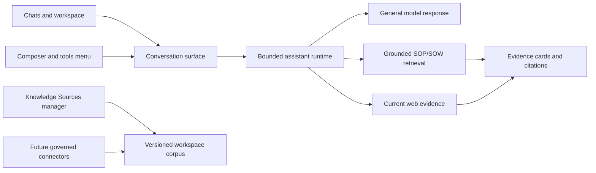

# Nexus assistant product architecture

Verified 31 October 2026. This document maps observable assistant-product patterns to Nexus; it does not claim access to ChatGPT source code, prompts, infrastructure, or proprietary internals.

## Product model

Official ChatGPT guidance describes projects as containers for related chats, files, instructions, and connected sources, while each chat keeps a focused transcript. Nexus adopts that observable separation:

- **Chat:** one durable conversation and its messages.
- **Workspace:** owner-scoped collection of chats, knowledge sources, memories, and policy.
- **Knowledge Sources:** separately managed SOPs, SOWs, policies, tables, and later connector-backed repositories.
- **Tools:** explicit capabilities such as grounded retrieval, web search, calculation, and later coding actions.
- **Memory:** bounded working history, explicit semantic preferences, verified episodic feedback, and code-owned procedures.
- **Skills:** versioned operator-authored workflows and response contracts. Skills are instructions, not evidence and not unrestricted code.
- **Agents:** bounded planner/executor roles operating through allowlisted tools, budgets, cancellation, approval, and audit events.

## User experience

Main conversation surface contains no drag/drop ingestion area. Users manage workspace knowledge through a compact modal, then reuse those sources across chats. Composer exposes tools and response settings without making ingestion dominate the product.

## Response modes and trust

1. **General chat:** available without connected sources. Response is model knowledge, explicitly marked as having no workspace or web evidence. It must not claim access to SOPs, SOWs, connectors, or current information.
2. **Workspace knowledge:** retrieval runs against one pinned corpus version. Claims require evidence IDs and source cards.
3. **Web search:** current results are untrusted evidence, URL-bounded, and cited separately from workspace documents.
4. **Combined mode:** later work may merge connector snapshots and live reads, but every result must retain origin, timestamp, permission context, and citation.

Memory never becomes evidence. Semantic memory may guide presentation or terminology only after facts come from current evidence.

## Component boundaries

- `app/static/index.html`: chat shell, conversations, composer tools, Knowledge Sources modal, citations, memory drawer.
- `app/server.py`: authenticated workspace boundary, general-chat dispatch, grounded graph dispatch, conversations, ingestion jobs.
- `storage/workspaces.py`: versioned local knowledge publication; later connector snapshots use the same repository boundary.
- `langgraph_flow/`: bounded planning, routing, retrieval, tools, and answer generation.
- `memory/`: explicit stores with separate trust, ownership, retention, review, and deletion rules.
- Future `connectors/`: registry, grants, sync cursors, revocation, source ACLs, freshness, and deletion propagation.
- Future `runtime/events`: durable tool-call status, streaming, cancellation, approval, and audit history.

## Implemented now

- Chat-first responsive interface with recent conversations and search.
- Source-free general chat with an explicit no-evidence result contract.
- Separate compact Knowledge Sources manager using existing bounded ingestion jobs.
- Composer tool menu for knowledge, web search, prompt library, and response controls.
- Existing citations, source cards, workspace isolation, semantic memory, and feedback review remain available.
- Desktop and mobile layouts validated; mobile DOM width equals viewport and sidebar opens without overflow.

## Not implemented yet

- SharePoint, Google Drive, OneDrive, S3, email, or database connectors.
- Connector OAuth/grants, ACL synchronization, live read versus indexed snapshot selection, and revocation propagation.
- Streaming tokens/tool events, stop/cancel control, artifact canvas, voice, image generation, scheduled tasks, and coding sandbox.
- Multi-agent execution UI, approval gates, conflict-safe parallel writes, and durable tool-event replay.
- Trusted production sign-in and multi-host transactional storage.

## Build order

1. Connector registry and one read-only SOP/SOW connector with test identity and revocation.
2. Source picker per workspace/chat plus freshness and permission metadata.
3. Streaming response and durable tool-event model with cancellation.
4. Artifact panel for generated plans, documents, tables, and code diffs.
5. Bounded coding tools in an isolated workspace; one agent before parallel workers.
6. New held-out evaluation covering general chat honesty, connector ACLs, freshness, citations, and tool failure recovery.

Fine-tuning remains separate. Retrieval, connector, permission, and interface failures must be fixed before model training is considered.
