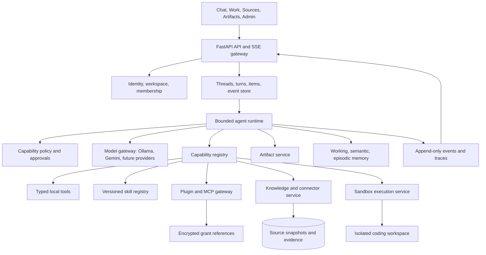

# Nexus capability reverse engineering and target architecture

Verified 3 November 2026 against current repository code, the 200-test offline baseline, and public OpenAI documentation. This is clean-room product analysis. It maps observable behavior and public contracts; it does not claim access to ChatGPT source code, private prompts, training data, or proprietary infrastructure.

## Executive decision

Nexus should not become a larger document-QA graph with more conditional branches. It should become a capability platform with document intelligence as its first mature capability.

Keep the proven ingestion, retrieval, evidence, conversation, and memory code. Add a thin assistant kernel around it:

1. durable threads, turns, items, and events;
2. one policy-enforced capability registry;
3. separate tool, skill, plugin, and connector contracts;
4. a bounded model/tool loop with approval and cancellation;
5. artifact and execution services outside the chat transcript;
6. local Ollama as one model provider, never as the authority for permissions.

The next implementation must be Step 20, the capability and event kernel. Building external connectors, arbitrary skills, or parallel coding agents before this kernel would create incompatible execution paths and weak audit boundaries.

## Verified public product patterns

Public OpenAI documentation establishes the following observable patterns:

- A project groups related chats, files, instructions, and connected sources; each chat keeps its own transcript. [Projects and chats](https://learn.chatgpt.com/docs/projects)
- Chat handles conversations; Work handles larger, multi-step deliverables. Plugins connect external services, while skills encode repeatable workflows. [ChatGPT on the web](https://learn.chatgpt.com/docs/web)
- A skill is a folder centered on `SKILL.md`, with metadata, workflow instructions, and optional references, scripts, templates, and assets. Skills guide how tools are used; they do not replace tool authentication or authorization. [Skills](https://developers.openai.com/plugins/concepts/skills)
- A plugin packages skills, MCP configuration, or both. A plugin manifest identifies its capability directories and MCP servers. [Plugins](https://developers.openai.com/api/docs/guides/agents-api/tools/plugins)
- Tools can include functions, web search, MCP, skills, shell, computer use, image generation, file search, and deferred tool search. [Using tools](https://developers.openai.com/api/docs/guides/tools)
- Agent sessions expose event streams and saved history for model activity, tools, subagents, failures, cancellation, and usage. [Observability and usage](https://developers.openai.com/api/docs/guides/agents-api/observability)
- Rich chat surfaces use streamed items, widgets, and actions rather than encoding every result inside one Markdown assistant message. [Advanced ChatKit integrations](https://developers.openai.com/api/docs/guides/custom-chatkit)
- Authenticated MCP tools should enforce OAuth and authorization server-side. Destructive actions require explicit consent, validation, and audit logging. [Plugin authentication](https://developers.openai.com/plugins/build/auth), [Security and privacy](https://developers.openai.com/plugins/guides/security-privacy)

These sources describe contracts and visible behavior, not ChatGPT's private implementation. Nexus should reproduce useful contracts with its own local-first design.

## Current repository: what is real

### Strong foundation already implemented

- **Chat shell:** responsive chat-first UI, durable conversation list, general chat, composer tools, source cards, and a separate Knowledge Sources modal.
- **Identity boundary:** explicit local development mode and an `auth_proxy` adapter; workspace membership and reviewer roles are server-derived.
- **Conversation persistence:** owner-scoped SQLite threads, turns, summaries, idempotency, leases, delete, and restart recovery.
- **Knowledge:** bounded parsing, OCR, token-aware chunks, provenance, immutable corpus versions, compatible FAISS indexes, tables, hybrid retrieval, reranking, citations, and evidence sufficiency.
- **Memory:** separate working, semantic, episodic, and procedural boundaries with retention, review, export, and deletion.
- **Execution controls:** bounded ingestion jobs, cooperative cancellation, chat capacity, deadlines, safe failure codes, and provider fallback.
- **Model providers:** Gemini and local Ollama behind a narrow provider wrapper.
- **Evaluation:** 200 deterministic tests plus failure audits, retrieval/table checks, memory evaluation, migration rehearsal, and label-blind local-model tooling.

### Names that currently overstate capability

- `agents/` contains fixed graph functions. It is not yet a general agent runtime.
- `agents/react_agent.py` performs one model generation and is not wired into the active graph. It is not an iterative ReAct loop.
- `utils/prompt_skill.py` loads one operator-selected prompt file. It is not a skill registry, dependency resolver, permission model, version manager, or progressive-disclosure loader.
- `app/prompt_library.py` stores prompt templates. Templates are not skills.
- `agents/tools.py` contains local helper functions. There is no typed tool registry, schema discovery, approval policy, or per-tool authorization.
- Web search is one Tavily path. There is no multi-step research runtime, fetch/extract pipeline, domain policy, or durable research report.

### Missing capability layers

Critical gaps:

- no durable turn-event stream or resumable server-sent events;
- no canonical item model for messages, tool calls, approvals, artifacts, and errors;
- no capability registry or policy decision point;
- no real skill packages or repository-local `.agents/skills/`;
- no plugin manifest, MCP client/gateway, OAuth grant store, or installation lifecycle;
- no external SOP/SOW connector, sync cursor, ACL propagation, freshness, or revocation;
- no iterative model/tool loop;
- no human approval state machine for consequential actions;
- no artifact service for documents, plans, tables, code diffs, or generated files;
- no isolated shell, filesystem edit, browser, or computer-use runtime;
- no coding-agent workspace, diff review, command allowlist, or rollback;
- no subagent scheduler, budget allocation, result aggregation, or conflict control;
- no production identity provider, secret vault, PostgreSQL adapter, or multi-host worker system.

Important product gaps:

- no token streaming or Stop control;
- no branch, pin, archive, share, export, or project instruction UI;
- no per-chat source picker or connector freshness view;
- no model/reasoning selector backed by capability policy;
- no inline tool progress, approval cards, widgets, or artifact preview;
- no voice, image generation, image input, scheduled tasks, or notifications;
- no admin UI for plugins, skills, connections, permissions, audit, retention, or models.

### Voice and Wispr Flow boundary

No voice, audio, transcription, WebRTC, Whisper, text-to-speech, or Wispr integration exists in this repository at commit `31e0c3a69b8e28d02530159f1bc77d3ca1226b31`.

Wispr Flow's public product documentation describes system-level dictation that inserts polished text into any application, including developer tools. Its public help documentation requires microphone and, on some platforms, accessibility permissions. The reviewed public documentation does not establish a supported embeddable Wispr SDK or API contract for Nexus. Therefore:

- **Wispr dictation mode requires no Nexus backend integration.** Users dictate into the existing composer; Nexus receives ordinary text and must not claim custody of Wispr audio.
- **Do not automate Wispr through accessibility hooks.** That would add fragile platform permissions and a second ungoverned input path.
- **A direct Wispr adapter remains unknown** until vendor-supported API documentation, enterprise terms, authentication, retention, and error contracts are supplied.
- **Native conversational voice is a different capability.** It requires audio transport, turn detection, interruption/barge-in, speech output, transcript events, session cleanup, and tool authorization. It must reuse Nexus thread, capability, approval, event, and audit contracts.
- **Voice implementation is excluded from Steps 20–31.** It can start only after the separate voice repository and its permissions are provided. Core platform work must not depend on it.

Public design references: [Wispr Flow for developers](https://wisprflow.ai/developers), [Wispr Flow setup](https://docs.wisprflow.ai/articles/3152211871), [Wispr data controls](https://wisprflow.ai/data-controls), and [OpenAI Realtime](https://developers.openai.com/api/docs/guides/realtime).

Maintainability gaps:

- `app/server.py` is a 902-line API/service composition root;
- `app/static/index.html` is a 1,221-line single-file SPA;
- request execution, persistence, policy, and transport concerns are still coupled;
- SQLite is correct for the single-host prototype but not for multi-host workers;
- provider models are invoked through LangChain wrappers without a unified streaming/tool-call protocol.

## Target capability model

Use these terms consistently:

- **Tool:** typed callable capability. Owns input/output schema, authorization, timeout, idempotency, and risk class.
- **Skill:** versioned workflow instructions plus optional packaged resources. It may select or compose tools but grants no permissions.
- **Plugin:** installable bundle containing skills and/or MCP server definitions, with manifest, version, publisher, permissions, and lifecycle.
- **Connector:** authenticated data integration producing live reads or indexed source snapshots. It is not itself evidence until results carry origin, time, and permission context.
- **Agent:** model-driven turn runner that can choose allowed tools within budget and policy.
- **Subagent:** bounded delegated run with explicit objective, inherited scope, isolated budget, and returned result.
- **Artifact:** durable user-visible output such as a plan, document, table, chart, code patch, or report.
- **Event:** append-only lifecycle record used by streaming UI, recovery, audit, and observability.

## Target system architecture



### Mandatory request flow

1. API resolves authenticated principal and workspace.
2. Session service reserves an idempotent turn.
3. Policy builds an allowed capability view for this principal, workspace, and turn.
4. Skill router loads metadata first, then only matched `SKILL.md` content.
5. Model receives bounded context and allowed tool schemas.
6. Runtime executes zero or more tool calls, each re-authorized server-side.
7. Consequential calls enter `approval_required`; execution cannot continue without a valid approval record.
8. Every lifecycle change appends an event.
9. User-visible text, citations, tool results, and artifacts are persisted as typed items.
10. Turn ends as `completed`, `failed`, or `cancelled`; partial artifacts remain inspectable.

Never persist or expose hidden chain-of-thought. Persist tool calls, evidence, concise execution summaries, model/tool metadata, and user-visible reasoning only.

## Core contracts

### Session and event contracts

Required entities:

- `Thread`: workspace, owner, title, mode, project instructions, created/updated/archive state.
- `Turn`: thread, idempotency key, status, model policy, budgets, start/end timestamps, cancellation state.
- `Item`: ordered message, tool call, tool result, approval, artifact reference, citation group, or error.
- `Event`: monotonic sequence, type, turn ID, item ID, safe payload, timestamp, trace correlation.

Minimum event types:

- `turn.created`, `turn.started`, `turn.cancel_requested`;
- `message.delta`, `message.completed`;
- `tool.requested`, `tool.started`, `tool.completed`, `tool.failed`;
- `approval.required`, `approval.resolved`;
- `artifact.created`, `artifact.updated`;
- `agent.delegated`, `agent.completed`;
- `turn.completed`, `turn.failed`, `turn.cancelled`.

SSE must support `Last-Event-ID`, owner/workspace authorization, heartbeat, reconnect, bounded retention, and terminal replay.

### Capability contract

Every capability needs:

- stable ID, kind, version, description, schemas, and owner;
- risk class: read, write, consequential, destructive;
- required scopes and workspace policy;
- execution target, timeout, retry/idempotency policy, and concurrency budget;
- network/filesystem requirements;
- audit and redaction policy;
- health and availability state.

The model sees only capabilities already filtered by policy. Tool implementation still performs authorization on every call.

### Skill package contract

Proposed repository layout:

```text
.agents/skills/<skill-id>/
  SKILL.md
  references/
  scripts/
  templates/
  assets/
```

`SKILL.md` must contain `name` and `description`. Nexus adds a lock record outside the package containing package digest, version, source, enabled workspaces, required capability IDs, reviewer, and activation time.

Rules:

- metadata is indexed at startup; full instructions load only after a match;
- skills never create permissions;
- scripts are disabled by default and execute only through sandbox tools;
- package paths remain inside the skill root; symlinks and traversal fail closed;
- every activation is version-pinned and auditable;
- user content cannot silently install or modify a skill.

### Plugin and MCP contract

Proposed plugin layout:

```text
plugins/<plugin-id>/
  .nexus-plugin/plugin.json
  .mcp.json
  skills/
```

Plugin lifecycle: discovered -> validated -> installed -> connected -> enabled -> disabled/revoked -> removed.

The manifest records publisher, version, skill path, MCP definitions, requested scopes, allowed origins, and integrity digest. MCP discovery results become typed capability records. Tokens remain in an encrypted vault; database rows hold only grant references. OAuth uses authorization code + PKCE where supported. Revocation immediately removes capabilities and invalidates caches.

### Connector and knowledge contract

Separate connection, source, snapshot, and evidence:

- `ConnectionGrant`: principal, connector, scopes, vault reference, status, expiry.
- `Source`: remote stable ID, display name, MIME/type, ACL fingerprint, deletion state.
- `SourceSnapshot`: source, revision/etag, sync cursor, content digest, indexed version, fetched time.
- `EvidenceItem`: snapshot ID, locator, excerpt, scores, origin, fetched time, permission context.

First production connector should be read-only and narrow: one governed SOP/SOW source such as SharePoint or Google Drive. It must support list, fetch, incremental sync, revocation, deletion propagation, ACL filtering, freshness display, and citations before write actions are considered.

### Coding runtime contract

Coding assistant must not call host shell directly from model output. Required boundary:

- isolated workspace per run;
- read, search, patch, format, test, and bounded shell tools;
- explicit working directory and allowlisted commands;
- CPU, RAM, wall-clock, output, process, and network limits;
- no secret inheritance by default;
- diff preview and approval before consequential external writes;
- append-only command events and captured exit status;
- cleanup and recovery after cancellation.

Start with one coding agent. Add parallel agents only after file ownership, patch merge, conflict detection, shared-state isolation, budget aggregation, and cancellation are proven.

## Incremental package architecture

Avoid a big-bang rewrite. Introduce these packages around existing modules:

```text
app/api/                 # HTTP/SSE routes and schemas only
domain/                  # Thread, turn, item, event, capability contracts
runtime/                 # Turn runner, model loop, budgets, cancellation
runtime/events/          # Append/read/replay event repository
policy/                  # Capability filtering, scopes, approvals
capabilities/tools/      # Typed built-in tools and registry
capabilities/skills/     # Discovery, validation, matching, activation
plugins/                 # Manifest validation, install state, MCP gateway
connectors/              # Grants, adapters, sync, ACL/freshness
artifacts/               # Durable generated outputs and previews
execution/               # Sandbox and coding workspace adapters
models/                  # Streaming/tool-capable provider interface
observability/           # Traces, metrics, audit, redaction
```

Existing `ingestion/`, `retrieval/`, `vector_Store/`, `memory/`, and `storage/` remain. Move code only when a new interface needs it; do not rename proven packages for cosmetic consistency.

## Build roadmap and gates

### Step 20 — capability and event kernel

Build domain types, SQLite event repository, capability registry, policy filter, turn state machine, and ADRs. Wrap current chat execution as one legacy capability so behavior stays stable.

Gate: idempotent event ordering, authorized replay, terminal recovery, policy-denied tools never reach the model, cancellation state is durable, and all 200 existing tests still pass.

### Step 21 — versioned skill runtime

Build repository-local skill discovery, strict `SKILL.md` parser, digest/version lock, progressive loading, workspace enablement, dependency checks, and read-only admin APIs. Convert the current prompt profile into the first built-in skill without changing answer behavior.

Gate: traversal/symlink/duplicate-name rejection, disabled skills never load, instructions cannot grant tools, activation is auditable, and deterministic routing tests pass.

### Step 22 — connector registry and first SOP/SOW source

Build grants, sources, snapshots, sync runs, cursors, ACL/freshness, revoke/delete propagation, and one read-only adapter. Keep local upload as an optional source type outside the main chat.

Gate: cross-user isolation, expired/revoked grants fail closed, incremental sync is idempotent, deleted remote sources disappear, stale snapshots are labeled, and every answer cites a snapshot.

### Step 23 — streaming turns and cancellation

Add append-only item/events, SSE replay, token/tool progress, reconnect, Stop control, and terminal error rendering. Adapt model gateway for streaming without making provider-specific events public contracts.

Gate: reconnect resumes without duplicate text, cancelled turns cannot later complete, slow clients are bounded, authorization applies to every stream, and non-streaming fallback remains correct.

### Step 24 — bounded tool loop and approvals

Replace fixed one-pass dispatch with a capped model/tool loop using typed tool schemas, per-turn call/token/time budgets, idempotency, retries only for safe tools, and approval states.

Gate: maximum-step enforcement, malformed tool calls rejected, write tools require approval, repeated requests do not duplicate writes, failures remain visible, and no hidden chain-of-thought is stored.

### Step 25 — plugin and MCP gateway

Build plugin manifest validation, installation state, MCP discovery/call adapter, OAuth grant references, scope filtering, health, disable/revoke, and audit UI. Begin with one read-only test MCP server.

Gate: malicious manifests fail, tokens never enter prompts/logs, per-tool scopes are enforced, prompt-injected tool calls cannot bypass policy, revoked plugins disappear immediately, and plugin failure degrades cleanly.

### Step 26 — Work mode and artifacts

Add Chat/Work mode, durable artifacts, revisions, preview/download, inline widgets/actions, and citations linked to artifact regions. Keep artifact data separate from assistant message text.

Gate: artifacts survive restart, revisions are immutable, actions are typed and authorized, unsafe HTML is isolated/sanitized, and deleting a thread follows explicit artifact retention policy.

### Step 27 — isolated coding assistant

Add workspace service, file read/search/patch, bounded shell/test tools, diff viewer, command events, approval, and cleanup. Use local Ollama only if tool-selection evaluation passes; allow a stronger configured provider without changing tool security.

Gate: path escape, secret access, forbidden command, network escape, fork bomb, output flood, timeout, cancellation, and conflicting patch tests all fail safely.

### Step 28 — controlled subagents

Add delegation only for independently testable work: research branches, code review, test diagnosis, or document synthesis. Parent assigns objective, capabilities, budget, and expected result schema.

Gate: total budgets include children, cancellation propagates, delegated writes are isolated, conflicts surface for review, trace shows ownership, and single-agent baseline remains available.

### Step 29 — research and live extraction

Build search/fetch/extract tools with domain and redirect policy, SSRF protection, byte/type/time limits, robots/licensing policy, freshness, citations, and long-running research jobs.

Gate: private-network targets blocked, untrusted page instructions cannot change policy, citations resolve to fetched evidence, interrupted research resumes, and source coverage is measurable.

### Step 30 — multimodal, tasks, and notifications

Add image input/generation, scheduled tasks, background jobs, and notifications through the same capability, event, approval, and audit contracts. Native voice remains a separate post-foundation workstream.

Gate: media limits and moderation, schedule ownership, quiet/no-change behavior, delivery retries, cancellation, retention, and user-visible provenance.

### Step 31 — production identity and scale

Deploy real OIDC identity, encrypted secret storage, PostgreSQL repositories, workers, queues, object storage, quotas, audit export, backup/restore, retention, and disaster recovery.

Gate: multi-host concurrency, tenant isolation, failover, restore, key rotation, revocation latency, load targets, accessibility, and independent security review.

## Acceptance trace for the core platform

- **AC-20:** every model-visible capability is registered, versioned, and filtered by server policy; denied capabilities never reach model context.
- **AC-21:** skills load progressively from validated, digest-pinned packages and cannot grant themselves tools.
- **AC-22:** an authorized user can connect, sync, cite, and revoke one read-only SOP/SOW source without cross-user leakage.
- **AC-23:** chat reconnect resumes ordered events without duplicate text; Stop produces one durable terminal outcome.
- **AC-24:** tool execution is bounded by calls, tokens, time, risk, idempotency, and approval state.
- **AC-25:** plugin/MCP tokens never enter prompts, results, artifacts, or logs; revocation removes capabilities immediately.
- **AC-26:** Work artifacts survive restart with immutable revisions and authorized actions.
- **AC-27:** coding tools cannot escape the isolated workspace, inherit secrets, or execute unapproved consequential commands.
- **AC-28:** parent and child agent budgets, permissions, cancellation, and results remain traceable and conflict-safe.
- **AC-29:** live extraction blocks private-network targets and cites the exact fetched evidence and freshness time.
- **AC-30:** scheduled and multimodal jobs share ownership, cancellation, retention, provenance, and notification policy.
- **AC-31:** production identity, vault, database, workers, backup, restore, and tenant isolation pass independent review.

Voice acceptance criteria will be defined from the separate authorized voice repository. Wispr dictation acceptance for this repo is limited to ordinary Unicode composer text behaving identically to typed text.

## Explicit non-goals until foundations pass

- Do not fine-tune Ollama to compensate for missing tools, evidence, or policy.
- Do not allow arbitrary skill scripts on the host.
- Do not install plugins directly from chat text.
- Do not add parallel coding agents before one isolated coding agent is reliable.
- Do not store connector tokens in SQLite plaintext, prompts, artifacts, or logs.
- Do not expose hidden chain-of-thought.
- Do not market exact ChatGPT parity; measure each capability against Nexus acceptance tests.

## Immediate Step 20 file plan

Add:

- `domain/capabilities.py`
- `domain/events.py`
- `runtime/turns.py`
- `runtime/events/repository.py`
- `policy/capabilities.py`
- `capabilities/registry.py`
- `tests/test_capability_registry.py`
- `tests/test_turn_events.py`
- `docs/adr/0001-capability-kernel.md`

Adapt, without rewriting:

- `app/server.py` to delegate turn execution and expose authorized event replay;
- `storage/conversations.py` to link existing turns to canonical events;
- `agents/orchestrator_agent.py` behind a provider-neutral response interface;
- `app/static/index.html` only after event replay exists.

Step 20 should not add external connectors, MCP network calls, shell execution, or subagents. Its purpose is to create one safe contract that all of them can later share.
