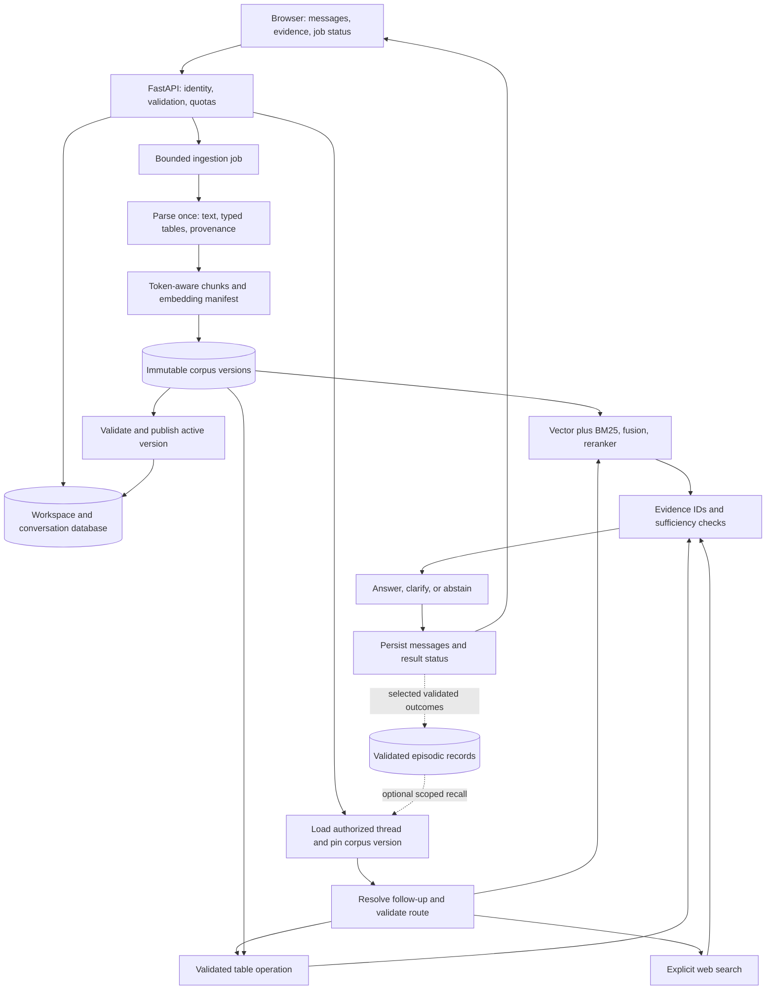

# RAG Architecture Implementation Plan

**Status: Steps 0–13 have implemented local slices; the Step 13 deterministic memory foundation passes, 28 October 2026.** See the linked result document in each step. The full baseline passes 187 offline tests and all six stages; diagnostics show zero reproduced defects, 25 not reproduced, one passing rejection control, zero failed controls, and zero probe errors. Step 12 release evidence, shared identity-provider deployment, and production validation remain incomplete. This plan translates the [architecture audit](../ARCHITECTURE_REVIEW.md) into reviewable steps; confirmed failures and untested attack hypotheses remain separate.

## Outcome and architecture decisions

Build an assistant that isolates users, preserves evidence and conversations, calculates correctly, and exposes failures. Keep FastAPI, LangGraph, Pandas, FAISS, and the existing UI. Extend the current packages.

Start with one application process, local artifacts, and persistent SQLite storage behind repository interfaces. Shared deployment requires authenticated identity; a development identity is allowed only in an explicit loopback-only mode. A client-supplied workspace ID never establishes ownership. A shared database and separate workers follow when deployment requirements justify them.

Preserve today's **replace-corpus upload behavior**, but make replacement atomic. Append/merge remains a separate feature. Each request pins one corpus version. Conversation history survives replacement, while references to old sources are marked stale. Provider credentials stay in server configuration; only workspace preferences enter the database.

## Target architecture

Document vectors, conversation checkpoints, episodic records, and RAM caches have separate lifecycles. Checkpoints contain serializable values and IDs, never live FAISS objects, DataFrames, models, or credentials.

Proposed contracts:

- `RequestContext`: principal, workspace, conversation, request ID, deadline, pinned corpus version.
- `CorpusVersion`: source IDs/hashes, parser/chunker versions, embedding fingerprint, metric, table schemas, checksums, readiness.
- `ToolPlan`: route, source/table ID, allowed operation, columns, typed filters, ambiguity status.
- `EvidenceItem`: stable chunk/row ID, source/version/page/sheet, excerpt, scores, origin.
- `AnswerResult`: answered/needs-clarification/insufficient-evidence status, citations, tool results, degradation flags. Infrastructure failures use structured API errors.

## Process at every step

**Inspect → write the desired-behavior test → implement a focused change → run checks → demonstrate the scenario → update the audit.** Report changed files, before/after behavior, evidence, limitations, and next action. Complete each gate before dependent work. Diagnostic success currently means failures reproduced; it is not a regression-test pass.

Use small patches within each step. Keep planning separate from implementation. Before the major architecture change, prepare the issue requested by the repository README; publishing requires explicit user instruction. No commit, push, or deployment is included in this plan.

## Step 0 — Baseline and test contract

**Completed:** 28 offline tests, 11 labeled evaluation cases, all 26 diagnostic IDs assigned to future steps, and a 117-package installed dependency snapshot. Tests pass; 25 diagnostic failures/limitations remain reproduced. Real-model quality and fresh-environment installation remain unverified. The provisional workload below is a development target, not a production performance promise. Details: [BASELINE.md](BASELINE.md).

**Implement:** preserve the dated diagnostic evidence. Add a development test runner and synthetic fixtures under `tests/`; record supported Python and dependency versions reproducibly. Introduce desired-behavior regression assertions with each repair. Do not hide known failures with blanket skips or tests that merely assert broken behavior.

Create a labeled evaluation set for PDF QA, CSV calculations, follow-ups, absent answers, duplicate sources, conflicting versions, multilingual terms, and hostile instructions. Record expected evidence as well as answers. Separate offline deterministic checks from opt-in real-model evaluation.

**Files:** development requirements, `tests/`, `tools/audit_failure_modes.py`, `docs/`.

**Gate:** baseline runs without production data or network; every audit case maps to a step below. Record corpus size, target concurrency, hardware, latency budget, and quality targets before making performance promises.

## Step 1 — API boundaries and safe rendering

**Completed in code:** 50 offline tests and 14 browser sanitizer checks pass. M02/V01/P03 no longer reproduce; 22 other diagnostic failures/limitations remain. Chosen integration: explicit loopback-only local mode plus a fail-closed authentication-proxy adapter with server-owned membership. Real proxy/identity-provider deployment was not performed. A shared single workspace remains until Step 2. See [STEP1_RESULTS.md](STEP1_RESULTS.md).

**Covers:** M02, V01, V02; untested HTML/prompt-injection and upload-limit scenarios.

**Implement:** typed bounded messages, nonblank queries, constrained provider/route values, file-count and streamed-byte limits. Reject invalid input before model/parsing work. Establish authenticated request context and membership checks using an established identity integration for shared deployment.

Sanitize rendered Markdown, restrict unsafe URL schemes, and pin frontend dependencies. Treat retrieved text as untrusted evidence with source delimiters; prompts alone are not a security boundary. Return safe error codes and request IDs instead of raw exceptions.

**Files:** `app/server.py`, `app/static/index.html`, `utils/prompt_skill.py`; proposed `app/schemas.py`, `app/security.py`.

**Gate:** null roles and blank questions return 422; unsupported uploads still return 422; oversized payloads return 413. Browser fixtures verify hostile markup cannot execute. Forged identity is rejected. Full data isolation additionally requires step 2.

## Step 2 — Workspace storage and atomic corpus publication

**Completed:** SQLite workspace preferences/version pointers, immutable checked artifacts, persisted tables, explicit providers, authorized workspace selection, and safe legacy-index rejection. S01/S02/P01/P04 plus the mixed-upload failure A04 no longer reproduce. Concurrent repository and injected commit-failure tests pass; actual power loss, multi-process deployment, retention cleanup, and proxy integration remain unverified. See [Step 2 results](STEP2_RESULTS.md).

**Covers:** S01–S02, P01, P04; local artifact tampering and concurrent-save hypotheses.

**Implement:** replace global `_state` ownership with workspace repositories. Pass provider preferences explicitly; stop mutating process-wide environment settings per user. Persist typed tables and source metadata with vectors so restart restores the same capabilities.

Build replacements in new private directories. Validate artifacts and flush writes before transactionally switching the database's active-version pointer. Serialize publication per workspace. Readers pin a version; retain old versions while readers use them. A pre-publication crash leaves an orphan for cleanup, while a failed save leaves the previous version active.

Store docstore metadata in a validated non-executable format and reconstruct the FAISS wrapper. Do not automatically load legacy pickles: rebuild from originals or provide an explicit trusted migration. Checksums detect corruption; filesystem permissions still protect against malicious writers.

**Files:** `app/server.py`, `vector_Store/faiss_store.py`; proposed `storage/` interfaces and migrations.

**Gate:** clients cannot read/replace other workspaces or alter their providers; tables survive restart; failed saves preserve the previous corpus. Test simultaneous replacements and crashes before/after pointer publication.

## Step 3 — Bounded ingestion and complete provenance

**Local acceptance cases pass:** FastAPI parses each source once in a short-lived process with a 30-second deadline, two parser slots, bounded input/result sizes, and format-specific structural limits. Nullable numeric columns, token-bounded chunks, stable source/chunk provenance, JSON pointers, PDF coordinates, durable warnings, and atomic failure behavior pass. Local Tesseract handles bounded scanned PDFs/images, synthetic rotation/noise fixtures, and explicitly configured installed language packs; cloud OCR requires opt-in. A sampled 512 MiB parser-growth guard and 1.5 GiB emergency ceiling complement Linux's 2 GiB address-space limit. Synthetic current-machine measurements cover six parser cases at 110.6–144.1 MiB peak worker RSS, two concurrent OCR workers with a 286.7 MiB conservative peak sum, and 256 cached MiniLM embeddings at 595.4 MiB process peak. Linux enforcement, multilingual/handwriting quality, full-API load, and production concurrency remain unverified. See [Step 3 results](STEP3_RESULTS.md).

**Covers:** I01, parts of A04/A06; scanned PDF, layout, archive expansion, and RAM hypotheses.

**Implement:** parse once into text blocks, typed tables, coordinates, and extraction warnings. Preserve nullable numeric dtypes; create separate text for embedding. Apply tokenizer-aware chunking to every supported format, including JSON, slides, and tables, reserving space for prefixes/special tokens.

Assign stable source/version/chunk IDs and retain page/sheet/row references. Report empty extraction, OCR requirements, and partial capabilities. Bound archive expansion, page/row counts, OCR work, and parser runtime. Use isolated processes where hard cancellation is needed.

**Files:** `ingestion/file_loader.py`, `pdf_loader.py`, `semantic_chunker.py`, upload UI.

**Gate:** a fact near the end of long JSON is indexed; chunks fit tokenizer limits; nullable numbers remain numeric; scanned/unsupported content produces a warning instead of false readiness. Resource tests use controlled fixtures and hard limits.

## Step 4 — Embedding/index compatibility

**Local acceptance cases pass:** New corpus manifests record encoder dimension/fingerprint, exact L2 metric, and chunker version. The loaded model's configuration, tokenizer vocabulary, and weights enter the fingerprint. Incompatible dimensions or same-dimension encoders are rejected before native FAISS read; model-name/revision changes select separate cached instances. A repository rollback rehearsal passes with synthetic encoders. Locally cached MiniLM reopens a saved corpus with a fresh instance; equal-dimension BGE-small is rejected before native index loading. The embedding factory uses the standard local cache when the project cache is empty. See [Step 4 results](STEP4_RESULTS.md). Multi-process deployment remains unverified.

**Covers:** E01–E03.

**Implement:** resolve encoder identity, revision/local fingerprint, dimension, normalization, metric, tokenizer, and chunker version into immutable configuration. Include it in the corpus manifest and cache keys. Validate compatibility before activation/search. Model changes build a new corpus version; never reuse vectors from another coordinate system.

**Files:** `embeddings/Hugging_face_embedding.py`, `vector_Store/faiss_store.py`, manifest validation.

**Gate:** dimension mismatch and same-dimension incompatible encoders are rejected before search. Configuration changes select the correct cached model. Rollback restores a compatible model/index pair. Keep exact FAISS search as the reference.

## Step 5 — Correct routing and table operations

**Acceptance cases pass offline:** Question/source-aware deterministic routing now uses a validated `ToolPlan` for one allowlisted table operation and an optional typed equality filter. Explicit source/sheet selection, ambiguity/unsupported-operation clarification, exact Pandas results, row provenance, and structured API tool results are implemented. A01–A03 no longer reproduce; A06 was repaired in Step 3. See [Step 5 results](STEP5_RESULTS.md). Broader natural-language plans and multi-table operations remain outside this gate.

**Covers:** A01–A03, A06; ambiguous sources and unsupported calculations.

**Implement:** route using the question and server-owned source metadata. Produce a typed `ToolPlan`; an LLM may propose it, but code validates table IDs, columns, operations, filters, and permissions. Execute allowlisted Pandas operations without generated Python or `eval`. Clarify ambiguity and reject unsupported requests instead of summarizing the first table.

Start with sum/mean/min/max/count and typed filters. Add grouping/joins only with defined semantics and fixtures. Return source, selected rows, operation, null policy, and result. Final presentation must preserve calculated values.

**Files:** `agents/planner_agent.py`, `dataframe_tool.py`, `intent_classifier.py`, graph state.

**Gate:** PDF questions use retrieval even when CSV exists; second-table total equals 99, North-only total equals 10, and nullable-value total equals 40. Unknown columns or ambiguous sources produce clarification.

## Step 6 — Durable conversation memory

**Local acceptance cases pass:** server-owned SQLite transcripts, idempotent replay, expiring turn leases with heartbeat, stale-worker rejection, migration-safe shared-worker startup, scoped deletion, 90-day configurable retention, bounded extractive recap, cursor pagination, unresolved-reference clarification, reloadable UI, and responsive conversation controls are implemented. SQLite remains the sole transcript authority; graph objects stay request-scoped. Multi-host databases, semantic summarization, durable jobs, and hard model cancellation remain later gates. See [Step 6 results](STEP6_RESULTS.md).

**Covers:** M01–M04; reload loss, forged history, duplicate turns, ambiguous follow-ups.

**Implement:** retain one authoritative transcript. The first slice uses a SQLite conversation repository because graph state still contains live FAISS/Pandas objects and no SQLite checkpointer dependency is installed. Before adding a persistent LangGraph checkpointer, make graph state serializable and reconcile checkpoint ownership with that transcript. UI sends the new message and idempotency key, then reads persisted history. Prompt profiles control style only.

Move the blocking graph invocation out of the FastAPI event loop in this slice, with bounded execution and an explicit capacity response. The first slice uses a process-wide two-slot limit; per-workspace fairness belongs with Step 10's job scheduler. Full durable jobs, stage metrics, and multi-process load testing remain in Step 10. Conversation persistence must not increase event-loop blocking.

Serialize IDs and values in graph state, reconstructing live dependencies per request. Serialize turns within a conversation or reject conflicting submissions. Bound recent context and summarize older messages while retaining originals according to policy. Deprecate the disconnected memory helper or adapt it without shared mutable dictionaries.

Resolve follow-ups before retrieval: preserve the original question, create a standalone search query, and clarify unresolved references. History provides context, not authoritative evidence.

**Files:** `memory/conversation_memory.py`, `langgraph_flow/state.py`, `graph_builder.py`, `utils/prompt_skill.py`, API/UI.

**Gate:** history works without a profile and survives reload/restart; duplicate requests do not duplicate turns; threads remain isolated; “What is its deadline?” retrieves the previously discussed document; returned history cannot mutate persisted state.

Use a durable checkpointer: an in-memory saver cannot meet restart requirements. Cross-thread episodic storage remains separate. [LangGraph persistence documentation](https://docs.langchain.com/oss/python/langgraph/persistence).

## Step 7 — Hybrid retrieval and reranker lifecycle

**Local acceptance cases pass:** stable chunk IDs preserve duplicate-text provenance, normalized lexical matching excludes zero-overlap candidates, an empty evidence set produces an explicit insufficient-evidence status, bounded versioned BM25 caching replaces unscoped vector caching, and retryable reranker loading reports fallback and validates scores. R01–R04 no longer reproduce. Real-model quality/latency and calibrated FAISS sufficiency remain open. See [Step 7 results](STEP7_RESULTS.md).

**Covers:** R01–R04; provenance loss, weak evidence, stale caches, active `retrieval/reranker.py` concerns.

**Implement:** normalize BM25 consistently while preserving domain identifiers; discard zero-match lexical candidates. Fuse by stable chunk IDs and retain all source references for duplicate text. Key caches by workspace, corpus version, retrieval configuration, query, and count; bound memory and invalidate explicitly.

Replace permanently cached reranker `None` with lifecycle state: unloaded, ready, failed-with-retry-time. Cache successful models by immutable configuration; provide bounded backoff and explicit reload. Synchronize initialization, cap candidates/tokens, and validate score count and finite values. Return documents, scores, model identity, status, and degradation reason. Deterministic fused-order fallback stays available but becomes visible in traces/UI.

Calibrate evidence sufficiency on labeled data. RRF and raw cross-encoder scores are not universal probabilities. Tune candidate count against both quality and latency.

**Files:** `agents/retriever_agent.py`, `retrieval/reranker.py`, API result schema.

**Gate:** duplicate text retains both citations; normalized lexical fixtures match; absent evidence can abstain; temporary load failure recovers without process restart; fallback is observable; malformed scores cannot corrupt ranking. Compare reranking enabled/disabled on identical evaluation cases.

## Step 8 — Simpler graph and evidence-based answers

**Local acceptance cases pass:** one bounded response plan reaches QA, deterministic routing selects document/table/web paths, stable evidence IDs and pinned corpus versions back citations, unknown citation IDs fail closed, possible numeric conflicts stay visible, and missing stores abstain safely. The unscoped legacy memory helper is retired. All 25 historical defect probes no longer reproduce; one rejection control passes. Semantic claim support and real-model quality remain evaluation work. See [Step 8 results](STEP8_RESULTS.md).

**Covers:** A04–A05; unused planner output, legacy graph mismatch, source conflicts, unsupported answers.

**Implement:** use one validated routing/planning decision, deterministic where possible. Retain a plan only if downstream nodes consume it. Send resolved queries to retrieval and validated plans to table tools. Label QA evidence with stable IDs, preserving web/local origin and explicit search mode.

Check citation existence, source version, and exact tool-result preservation. Semantic support requires evaluation; an LLM verifier cannot guarantee truth. Allow at most one bounded retrieval retry, then clarify/abstain. Document the active graph; retire or repair unused entry points before exposing them.

**Files:** `langgraph_flow/graph_builder.py`, `state.py`, `agents/response_planner.py`, `qa_agent.py`, API/UI.

**Gate:** partial ingestion never routes into a null store; retained plans reach QA; unsupported questions abstain; citations exist; conflicts stay visible; retries respect a call budget. Demonstrate document/table/web paths.

## Step 9 — Selective episodic memory

**Local deterministic gate passes:** opt-in server-derived corrections, non-forgeable unverified/verified separation, owner/workspace/task/corpus/expiry-scoped recall, non-evidentiary prompt guidance, owner list/delete APIs, and conversation-delete cascade are implemented. Exact task matching is deliberate; reviewer workflow, similarity recall, and post-reindex revalidation remain open. See [Step 9 results](STEP9_RESULTS.md).

**Implement:** save selected analyses/corrections with workspace, task, tool plan, evidence versions, result, validation status, timestamp, and expiry. Separate unvalidated feedback from verified outcomes. Recall only authorized relevant episodes after freshness checks. Version corrections explicitly.

Start with structured task/source lookup. Add an episode embedding index only if evaluation justifies it, with a separate namespace/manifest. Do not automatically embed every chat turn. Propagate deletion through messages, summaries, checkpoints, episodes, and caches according to retention policy.

**Files:** proposed `memory/episodic_memory.py`, storage repositories, graph context loading, feedback UI.

**Gate:** verified corrections improve repeated tasks; stale/rejected/deleted/cross-workspace episodes are excluded. Compare with recall disabled and leave the feature off if it adds unsupported claims.

## Step 10 — Bounded execution and operational visibility

**Local deterministic foundation passes:** upload work is persisted as owner-scoped idempotent jobs, full ingestion runs off the event loop under bounded admission, expiring leases support shared-local-worker recovery, publication is replay-safe, and status/cancel APIs plus stage timing are exposed. Chat capacity, deadline, and provider failures now have distinct safe codes; timed-out native work retains its slot until exit. Production p95/model latency, browser heap, multi-process load, multi-host scheduling, and hard native-call cancellation remain open. See [Step 10 results](STEP10_RESULTS.md).

**Covers:** P02–P03; remaining concurrency/RAM hypotheses and provider availability.

**Implement:** move blocking work out of the event loop using bounded execution and backpressure. Use isolated workers for heavy ingestion/hard deadlines; cancelling an awaiting request does not necessarily stop native model/parser work. Add durable ingestion jobs with queued/running/ready/failed states and idempotent publication.

Limit workers, model instances, resident corpora, caches, and conversation context. Record stage/queue duration, tokens where available, degradation, and safe error codes. Distinguish capacity errors, deadlines, and provider failures. Keep readiness/UI consistent. Verify supported provider SDK/model configuration before release.

**Files:** `app/server.py`, `utils/llm_helpers.py`, proposed job service, UI error/status handling.

**Gate:** slow graph work does not stall lightweight requests; failures are not successful answers; restart recovers jobs; retries do not multiply jobs. Measure p50/p95 latency, peak RSS, browser heap, and errors under the step-0 workload. Cross-process tests are required before multi-worker support.

## Step 11 — Evaluation, migration, and index scaling

**Local evidence tooling passes; release remains blocked:** scorer now measures ranked evidence, citations, typed table results, abstention cleanliness, latency/tokens/cost, and manual semantic review while preventing development labels from becoming release evidence. Copy-only rollback rehearsal verifies previous/current versions without source mutation. Deterministic Flat/HNSW benchmarking is part of the baseline; current measurement keeps exact Flat. Combined release gate refuses completion without a separately frozen held-out real-model run. See [Step 11 results](STEP11_RESULTS.md).

**Implement:** run repaired regression cases and opt-in real-model evaluations. Measure evidence Recall@k/MRR, answer correctness, citation support, abstention, table accuracy, cost, and latency on held-out cases. ANN neighbor recall and relevance to a user's question are separate measurements.

Retain Flat as the reference. Benchmark HNSW when vector-search latency dominates and memory permits; evaluate IVF/PQ when measured scale/memory warrants training or compression. Compare recall, build time, RSS, update behavior, and end-to-end latency. Add LSH/Annoy or another backend only for a demonstrated need. [FAISS index selection guidance](https://github.com/facebookresearch/faiss/wiki/Guidelines-to-choose-an-index).

**Gate:** repaired deterministic cases pass; held-out quality meets baseline-derived release targets; authorization, restart, disk-failure, browser, parser, and concurrency checks have evidence. Rehearse migration on copies, retain the previous compatible app/schema/corpus version, and test rollback before deployment.

## Step 12 — Label-blind local-model release evidence

**Pipeline complete; release still blocked:** separate hashed inference/label bundles, real Ollama graph execution, per-call usage capture, review worksheet/attachment, dataset-retirement protection, and combined release gating are implemented. The first fresh release attempt failed citation precision and exposed follow-up version selection defects. It was retired before fixes; see [Step 12 results](STEP12_RESULTS.md).

**Implemented:** label leakage rejection; corpus/run identity matching; `llama3.2:3b` model revision capture; retrieval, citation, abstention, table, latency, and token evidence; explicit independent-review metadata; copy-only migration evidence; fallback relevance gating; exact version filtering.

**Gate:** only a never-executed `release_candidate` dataset may support a candidate. Once results influence code or labels, retire that dataset. Automated targets must pass before independent human review; the combined gate must still pass after review attachment.

**Next:** freeze release holdout v2 after the latest fixes, execute once, then obtain independent review if automated targets pass. Do not fine-tune while failures remain attributable to retrieval or reference resolution.

## Step 13 — Four-layer memory architecture

**Local foundation implemented:** working conversation memory and selective episodic feedback remain authoritative in their existing stores. Explicit semantic memory now supports scoped preferences/profile/constraints/terminology with expiry, inspection, deletion, secret/instruction rejection, and non-evidentiary prompt guidance. Procedural memory remains immutable graph/tool/prompt policy; see [Step 13 results](STEP13_RESULTS.md).

**Decision:** do not place all memory into one vector database. Working, semantic, episodic, and procedural memory have different owners, trust, retention, recall, and deletion rules. Never auto-promote chat text into semantic or procedural memory.

**Gate passed locally:** frozen deterministic checks prove cross-owner isolation, latest-value conflict handling, expiry, deletion, injection rejection, prompt evidence separation, and bounded local recall latency. Episodes still require verification and corpus match; procedures cannot be written through public memory APIs. Full baseline: 187 tests and all six stages pass.

**Next:** run a separate label-blind real-model memory evaluation before changing recall ranking. Add relevance-ranked semantic recall only if it beats bounded deterministic recall. Keep Ollama fine-tuning paused until the user begins the separate fine-tuning phase.

## Expansion after the foundation

The requested general assistant is a separate product scope beyond document QA. Build observable capabilities and measure them; exact replication of a proprietary assistant's internals is not a verifiable requirement.

1. **Identity and connectors:** complete the existing trusted sign-in boundary, then add a connector registry with per-user grants, source permissions, sync cursors, revocation, and deletion. Keep indexed snapshots distinct from live reads. Each connector result needs origin, timestamp, and citation.
2. **Live data and web extraction:** add allowlisted fetch/search tools with URL safety, timeouts, content-type and byte limits, source freshness, and injection-resistant evidence handling. Evaluate freshness, extraction accuracy, and citation support on held-out tasks.
3. **Agent runtime and interface:** add durable tool-call events, streaming status, cancellation, a bounded planner/executor loop, and explicit approval for consequential actions. Run independent tool calls concurrently only within per-workspace budgets. Show tool inputs/results, evidence, and failures in the chat interface.
4. **Coding assistant:** expose an isolated workspace with read/search/edit/test tools, diff review, command allowlists, resource limits, and audit logs. Start with one agent and deterministic task tests; add parallel coding workers only after merge/conflict handling and isolation tests pass.
5. **Fine-tuning gate:** first collect consented, redacted task traces and held-out evaluations. Separate retrieval/tool failures from model failures. Fine-tune only when the measured gap is model behavior rather than missing evidence or broken tools, and compare against the unfine-tuned local Ollama baseline.

## Delivery checkpoints and next action

- **A — Steps 0–2:** tests, API boundaries, isolated durable corpora. Demonstrate ownership and failed-save safety.
- **B — Steps 3–5:** bounded extraction, compatible embeddings, correct calculations. Demonstrate source-to-result lineage.
- **C — Steps 6–8:** durable conversations, observable retrieval/reranking, evidence-based answers. Demonstrate an end-to-end follow-up.
- **D — Steps 9–11:** optional episodic recall, measured operations, migration/scale decisions. Demonstrate release evidence.

**Next implementation action: run a label-blind real-model memory-quality evaluation or, when explicitly started, begin the separately governed Ollama fine-tuning phase. Fine-tuning remains paused now.** Exposed calibration and failed release-attempt sets are non-release evidence. Production rollout has not occurred. Multi-process load, multi-host storage, trusted review roles, identity-provider deployment, physical-device UI checks, multilingual OCR, cross-encoder deployment, and deployment-specific retention approval remain open.
